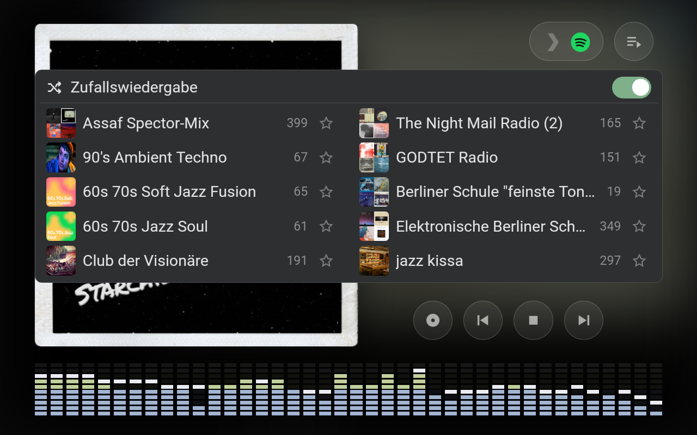

# Now Playing – Albumcover und Bedienung auf dem Lenovo Yoga

Ein altes Lenovo Yoga Tab 3 steht quer neben der Anlage und zeigt, was gerade läuft: links das Cover, rechts Interpret, Titel, Album und Jahr, unten eine LED-Leiste im Retro-Stil (Spektrumanalysator) in den Farben des Covers. Über Knöpfe auf dem Tablet lässt sich die Musik steuern: Stopp und Play, vor und zurück, ähnliche Titel einfügen (Song Radio), das ganze Album spielen, eine Playlist wählen und zwischen Plex und Spotify umschalten. Läuft keine Musik, geht das Display aus und mit der nächsten Musik von selbst wieder an.


| Playlist-Auswahl mit Favoriten und Zufallswiedergabe | Helles Cover (ältere Aufnahme, noch ohne Knöpfe) |
|---|---|
|  |  |

---

## Inhalt

| Ordner | Was | Wohin |
|---|---|---|
| [`raspberry/`](raspberry/) | Anzeige-Server, Anzeigeseite, Spektrum-Dienst, Einrichtung von Spotify Connect „PlexAmpPi“, Spotify-Anmeldung | Raspberry „PlexAmpPi“ |
| [`tablet-app/`](tablet-app/) | Android-App für das Yoga (Quellcode) | wird zur APK, dann aufs Tablet |
| [`vorschau/`](vorschau/) | Bildschirmfotos vom echten Tablet | nur zum Ansehen |

Jeder Ordner hat eine eigene `ANLEITUNG.md` mit allen Einzelschritten. Diese Datei gibt den Überblick.

---

## So hängt alles zusammen

```
Plexamp (Handy) ──► Caldera ──┐
                              ├─► Raspberry „PlexAmpPi“ ─► HiFiBerry Digi ─► Toslink ─► WiiM Amp ─► Lautsprecher
Spotify (Handy) ──► librespot ┘        │
                                       ├─ Spektrum-Dienst (Port 8090) ── 40 Bänder, 30×/s ───┐
Plex-Server (NAS) ── Titel, Cover ────►├─ Anzeige-Server  (Port 8080) ───────────────────────┼─► Lenovo Yoga
Spotify-Web-Schnittstelle ◄───────────►│   Songinfos, Cover, Display an/aus,                 │   (App, Vollbild)
WiiM (Radio, AirPlay) ── Titel, Cover ►┘   Befehle vom Tablet (Stopp, Skip, Playlist …) ◄────┘
```

Der Raspberry erledigt alles. Die NAS liefert nur die Musik und über Plex Titel, Cover, Playlists und ähnliche Titel; ein Docker-Container ist nicht nötig. Das Tablet spricht ausschließlich mit dem Pi und braucht keinen Internetzugang.

### Woher die Anzeige ihre Daten hat

| Was läuft | Quelle | Jahr | „Danach“ | Fortschritt | LED-Leiste |
|---|---|---|---|---|---|
| Plexamp → **PlexAmpPi** (Caldera) | Caldera auf dem Pi, Angaben und Cover vom Plex-Server | ja (Albumjahr) | ja | ja | ja |
| Spotify → **PlexAmpPi** (librespot) | librespot meldet jeden Titelwechsel; Playlist-Name über die Spotify-Web-Schnittstelle | – | – | – | ja |
| Direkt auf dem WiiM (Radio, AirPlay, Spotify → WiiM) | Schnittstelle des WiiM | – | – | ja, wenn der WiiM eine Länge meldet | – |

### Was das Tablet anzeigt

| Zustand | Anzeige |
|---|---|
| Musik läuft | Cover links; rechts Interpret (groß), Titel, Album · Jahr in Farben aus dem Cover; darunter die Zusatzzeile (siehe unten) und „Danach: …“; Knöpfe; unten Fortschrittslinie und LED-Leiste; unscharfer Cover-Hintergrund |
| Titelwechsel | Cover, Hintergrund, Text und Farben blenden in 1,5 s über. Bei Plexamp ist das nächste Cover schon vorgeladen. |
| Pause (Stopp-Knopf oder in der App pausiert) | Cover und Text abgedunkelt, der Stopp-Knopf wird zum Play-Knopf. Nach 3 Minuten (`PAUSE_DELAY`) geht das Display aus. |
| Musik zu Ende, Quelle weg | Cover abgedunkelt, nach 10 s (`OFF_DELAY`) geht das Display aus |
| Keine Musik | Display aus. Startet Musik, geht es nach 1–3 s wieder an. |
| Von Hand geweckt, ohne Musik | Der zuletzt gespielte Titel steht abgedunkelt mit Play-Knopf da; Play setzt an der letzten Stelle fort. Ohne Bedienung geht das Display nach 1 Minute wieder aus. |

**Zusatzzeile unter dem Album**

| Was läuft | Zeile |
|---|---|
| Playlist | Logo der Quelle (Plex oder Spotify) und Name der Playlist |
| Von „Song Radio“ eingefügte Titel | Funken-Symbol und „Song Radio: Interpret – Titel“ des Titels, auf den sich die Vorschläge beziehen |
| Ein ganzes Album in seiner Reihenfolge | Platten-Symbol und „Titel 3 von 10“; die Zeile „Danach“ entfällt |

Helle Cover dunkeln den Hintergrund stärker ab, schwarze Cover bekommen einen feinen Rand. Lange Texte brechen an sinnvollen Stellen um (Klammerzusätze und einzelne Interpreten bleiben zusammen); ein einzelnes überlanges Wort wird kleiner geschrieben statt getrennt. Wird der Textblock zu hoch, wird er gekürzt, bevor er in die Knöpfe ragt.

### Bedienung am Tablet

Untere Reihe, bündig mit dem Text:

| Knopf | Wirkung | Plex (Caldera) | Spotify auf dem Pi | WiiM |
|---|---|---|---|---|
| Platte | Album des laufenden Titels ab Titel 1 spielen. Ausgegraut, solange schon ein Album läuft. | ja | ja | – |
| Funken („Song Radio“) | Fügt zehn klanglich ähnliche Titel hinter dem laufenden ein; der laufende spielt weiter. Ausgegraut bei Titeln, die Plex noch nicht klanglich analysiert hat. | ja | – (Spotify gibt eigenen Apps keine Vorschläge mehr heraus) | – |
| Zurück | vorheriger Titel | ja | ja | ja |
| Stopp / Play | hält an (Pause) bzw. spielt an derselben Stelle weiter | ja | ja | ja |
| Vorwärts | nächster Titel | ja | ja | ja |

Obere Reihe rechts (Umschalter und Playlists stehen links neben dem Ansicht-Schalter):

| Knopf | Wirkung |
|---|---|
| Ansicht (dreiteiliger Schalter, immer ganz oben rechts) | Drei Felder, jedes zeigt seine Ansicht als kleines Bild; das Feld der laufenden Ansicht ist hell. Antippen wählt direkt: alle Infos mit LED-Leiste · ohne Leiste mit Infos (größeres Cover, Knöpfe unten rechts, wie in der Ansicht des WiiM) · nur das Cover (mittig, so groß wie möglich; alle anderen Knöpfe, Text und Fortschrittslinie sind ausgeblendet). Gilt für Plex und Spotify gemeinsam; der Pi merkt sich die Wahl. |
| Umschalter Plex / Spotify | Hält die laufende Quelle an und spielt die andere weiter (Plex an der letzten Stelle, Spotify dort, wo das Konto zuletzt war). Farbig ist das Logo der Quelle, die gerade läuft. Zu Spotify dauert es etwa 6 s, weil Caldera die Soundkarte erst 5 s nach der Pause freigibt. |
| Playlists | Klappt die Auswahl auf: bis zu zehn Playlists der laufenden Quelle in zwei Spalten, Favoriten zuerst, dann die zuletzt gespielten. Antippen startet die Playlist. Der Stern markiert einen Favoriten, ohne zu starten. Oben der Schalter „Zufallswiedergabe“: mischt die laufende Warteschlange und gilt für die nächste gewählte Playlist. Das Feld schließt sich nach 10 s ohne Bedienung. |

Läuft Musik direkt am WiiM (Radio, AirPlay, Spotify → WiiM), gibt es keine Leiste. Das Cover ist dann größer, die Knöpfe stehen unten rechts, und oben rechts steht nur der Umschalter (beide Logos grau, kein Playlist-Knopf). Antippen stellt den WiiM auf den optischen Eingang und spielt Plex an der letzten Stelle weiter. Dasselbe geschieht von selbst, wenn Plex oder Spotify auf dem Pi anders gestartet werden (z. B. aus der Plex-App), während der WiiM nicht auf dem optischen Eingang steht. Umgekehrt hält der Server Plex bzw. Spotify auf dem Pi an, sobald am WiiM eigene Musik startet (z. B. Spotify Connect am WiiM); das Tablet zeigt dann den WiiM.

Lange auf den Bildschirm drücken öffnet die Einstellungen der App.

Für Spotify (Umschalter, Knöpfe, Playlists) muss die Spotify-Web-Schnittstelle einmalig eingerichtet sein, siehe [`raspberry/ANLEITUNG.md`](raspberry/ANLEITUNG.md). Ohne sie bleibt Spotify eine reine Anzeige.

### Wichtig im Alltag

- Für Musik über den Pi muss der WiiM auf dem **optischen Eingang** stehen.
- **Lautstärke nur am WiiM regeln.** Caldera (Lautstärke 100) und Spotify liefern vollen Pegel; Spotify ist um 2 dB abgesenkt, damit beide etwa gleich laut sind (nach Gehör eingestellt, `SPOTIFY_PREGAIN`). Wird Calderas Lautstärke in der Plex-App verstellt, stimmt das nicht mehr.
- Caldera und Spotify teilen sich die Soundkarte: **Es spielt immer nur eine Quelle.** Der Umschalter am Tablet erledigt den Wechsel. Startest du die andere Quelle vom Handy aus, hält der Server die bisherige selbst an und bringt die neue zum Spielen; das dauert etwa 10–15 s (die Soundkarte wird erst nach 5 s frei).
- Spotify auf dem Pi: Alben und Playlists laufen durch; nach einem Einzeltitel stoppt die Wiedergabe, weil Autoplay dort nicht lädt.
- Der Anzeige-Server hat keine Anmeldung: Wer im Heimnetz ist, kann die Knöpfe auch auslösen.

---

## Einrichtung

1. **Raspberry:** [`raspberry/ANLEITUNG.md`](raspberry/ANLEITUNG.md) – Ordner auf den Pi kopieren, `sudo ./install.sh`; für die Spotify-Steuerung zusätzlich die einmalige Anmeldung.
2. **Tablet:** [`tablet-app/ANLEITUNG.md`](tablet-app/ANLEITUNG.md) – APK bauen und installieren, Adresse des Pi eintragen, Display-Steuerung aktivieren, Bildschirmsperre „Keine“.

### Einstellungen

| Was | Datei auf dem Pi | Vorlage im Repository |
|---|---|---|
| Anzeige-Server (Plex, WiiM, Spotify, Zeiten, Anzahl Playlists) | `/etc/default/nowplaying` | `raspberry/nowplaying.default.beispiel` |
| Spektrum (`DELAY_MS`, Empfindlichkeit) | `/etc/default/nowplaying-spectrum` | `raspberry/nowplaying-spectrum.default` |
| Spotify Connect (Name, Lautheit, Absenkung) | `/etc/raspotify/conf` | wird von `install.sh` gesetzt |
| Spotify-Anmeldung, Favoriten | `/var/lib/private/nowplaying/` | entsteht im Betrieb |

Nicht ins Repository gehören und sind per `.gitignore` ausgeschlossen: `raspberry/nowplaying.env` (lokale Kopie der Vorlage mit dem Plex-Token) und `raspberry/spotify.json` (Spotify-Anmeldung).

---

## Eingerichteter Stand (14.11.2026)

- **Raspberry** „PlexAmpPi“ (Pi 3B, HiFiBerry Digi, Debian 13, 192.168.178.68): Dienste `nowplaying`, `nowplaying-spectrum`, `raspotify` laufen.
  Caldera: Abtastrate der Quelle, Lautstärke 100, Lautheitsangleichung und Übergänge an. Spektrum-Verzögerung `DELAY_MS=0`. Spotify: Absenkung −2 dB, Web-Schnittstelle eingerichtet, Raspotify merkt sich die Anmeldung.
- **Tablet** Lenovo Yoga Tab 3 8" (YT3-850L, Android 6.0.1, 192.168.178.109): App 1.9, Adresse `http://192.168.178.68:8080`, Display-Steuerung aktiv, Bildschirmsperre „Keine“, nicht benötigte Apps entfernt bzw. deaktiviert, USB-Debugging an.
- **Getestet** mit echter Musik: Plexamp und Spotify über den Pi mit Cover, Songinfos und Leiste; Überblendung; Display aus und an; Stopp/Play, Skip, Song Radio, Album, Playlist-Start, Favoriten und Zufallswiedergabe bei Plex; Umschalter in beide Richtungen; Skip, Stopp, Play und Playlist-Start bei Spotify; „immer nur eine Quelle“ in beide Richtungen (andere Quelle am Server vorbei gestartet).
- **Noch nicht getestet:** alle Knöpfe am WiiM, die Ansicht des WiiM am Tablet und der Umschalter vom WiiM zu Plex; Album-Knopf, Favoriten und Zufallswiedergabe bei Spotify; Weiterlaufen der Seite nach Wecken von Hand ohne Musik (App 1.9); Display aus nach 3 Minuten Pause.

---

## Fehlersuche: Wo anfangen?

| Was du siehst | Wo nachsehen |
|---|---|
| Tablet zeigt gar nichts oder einen Ladefehler | Adresse in der App prüfen (lange drücken); läuft `nowplaying` auf dem Pi? |
| Display bleibt aus, obwohl Musik läuft | `http://192.168.178.68:8080/setup`: Zeigt eine Quelle einen Fehler? |
| Cover da, aber keine Leiste | Läuft die Musik über PlexAmpPi? `curl http://192.168.178.68:8090/status` |
| Leiste läuft dem Ton voraus | `DELAY_MS` in `/etc/default/nowplaying-spectrum` erhöhen |
| Leiste hinkt dem Ton hinterher | Steht `DELAY_MS` in `/etc/default/nowplaying-spectrum` auf 0? Weniger geht nicht; `install.sh` ändert eine vorhandene Datei nicht |
| Leiste ruckelt | Belegt die App einen ganzen Prozessorkern? Dann zeichnet die Seite dauernd neu (z. B. durch eine Animation in `index.html`). |
| Kein Ton über den Pi | WiiM auf optischem Eingang? Spielt gerade der andere Player (Caldera/Spotify)? |
| Umschalter und Spotify-Knöpfe fehlen | `/setup`: „Spotify-Steuerung: eingerichtet“? Sonst Anmeldung wiederholen (`np-spotify-login`). |
| „Zu Spotify“ tut nichts | Kennt das Spotify-Konto das Gerät „PlexAmpPi“? Einmal in der Spotify-App auswählen. |
| Funken-Knopf ausgegraut | Der Titel ist in Plex nicht klanglich analysiert; Analyse im Plex-Server anstoßen. |
| Spotify und Plex verschieden laut | Calderas Lautstärke auf 100? Pegel beider Quellen: `level_db` unter `http://192.168.178.68:8090/status` |
| Display geht ohne Musik nicht aus | In der App lange drücken → „Display-Steuerung aktivieren“ |

---

## Technik in Kürze

- **Anzeige-Server** (`raspberry/np-server`): Python 3, nur Standardbibliothek, systemd-Dienst. Fragt Caldera lokal ab (Plex-Companion-Schnittstelle), liest Calderas Warteschlange (nächster Titel, Playlist, Album), bekommt Spotify-Ereignisse von librespot und fragt den WiiM ab. Befehle vom Tablet (`/api/skip`, `prev`, `stop`, `play`, `similar`, `albumplay`, `shuffle`, `switch`, `playlist`, `favorite`) reicht er an Caldera, den Plex-Server, die Spotify-Web-Schnittstelle oder den WiiM weiter. Alle Cover laufen über den Server und werden vorab zwischengespeichert; so gibt es keine Zertifikatsprobleme mit dem alten Android.
- **Anzeigeseite** (`raspberry/index.html`): ES5-JavaScript für das Android-WebView. Zwei Ebenen zum Überblenden, Cover-Farben aus einem 32×32-Abbild des Covers, Abfrage jede Sekunde. Sie lädt sich selbst neu, sobald auf dem Pi eine neue Fassung liegt. Im Browser zeichnet sie die LED-Leiste selbst; in der Tablet-App übernimmt das die App.
- **Spektrum** (`np-spectrum-feed`, `np-spectrum-server`): Das ALSA-Gerät `nowplaying` reicht das Signal unverändert an die HiFiBerry weiter und gibt eine Kopie ab. Daraus werden per FFT (numpy) 40 Bänder von 40 Hz bis 16 kHz und per Server-Sent Events ans Tablet geschickt. Kommt der Dienst nicht hinterher, wird die Kopie verworfen – die Musik läuft immer weiter. `/status` nennt zusätzlich den mittleren Pegel (`level_db`).
- **Spotify:** Raspotify (librespot 0.8) spielt, feste Lautstärke, Lautheitsangleichung an, Absenkung −2 dB, Ereignisse über `np-librespot-event`. Gesteuert wird über die Spotify-Web-Schnittstelle (Anmeldung mit `np-spotify-login`, PKCE ohne Client-Secret); der Server gleicht alle 10 s ab, ob Spotify auf dem Pi spielt.
- **Tablet-App** (`tablet-app/`): Java, ohne Fremdbibliotheken, ab Android 5. Zeigt die Seite im Vollbild und zeichnet die LED-Leiste nativ auf einer eigenen Fläche darüber (in der Webansicht kostete sie einen ganzen Prozessorkern; jetzt braucht die App etwa ein Viertel eines Kerns). Schaltet das Display per Geräteadministrator aus und per WakeLock wieder ein, holt sich nach 60 s in den Vordergrund zurück, lädt eine Seite neu, die sich nicht mehr meldet, und startet nach einem Neustart von selbst.
