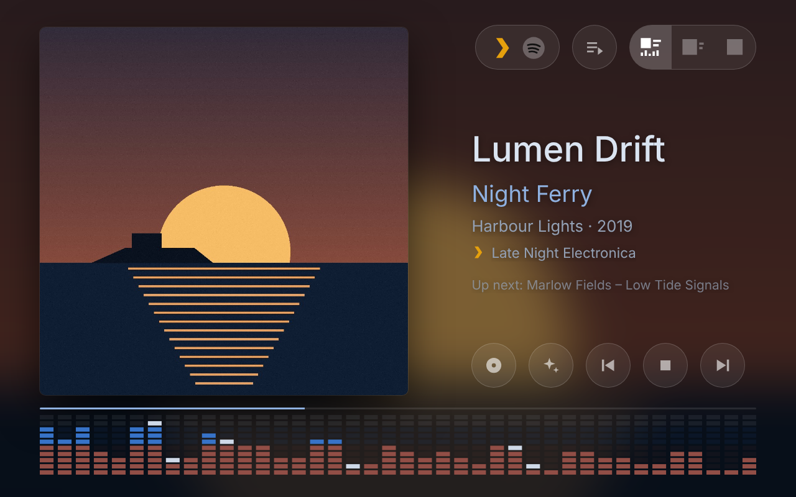

# Now Playing

A now-playing display for an old Android tablet next to the hi-fi: cover art, track info and a retro LED spectrum in the cover's colors, plus touch controls for Plexamp and Spotify. A Raspberry Pi does all the work; the tablet just shows a page. The display turns off when the music stops and back on when it starts.



| Playlist picker | Colors follow the cover |
|---|---|
|  |  |

## Features

- **Sources:** Plexamp headless (Caldera) and Spotify Connect (librespot) on the Pi; a WiiM streamer (radio, AirPlay) is shown too.
- **Display:** cover, artist, title, album and year, playlist or "Track n of m", up next, progress, 40-band LED spectrum, crossfade on track change.
- **Controls:** play/pause, previous/next, Song Radio (similar tracks, Plex only), play album, playlists with favorites and shuffle, Plex ↔ Spotify switch, three layouts (full, no spectrum, cover only).
- **Only one source at a time:** starting one source pauses the other.
- **Tablet app:** full screen, native spectrum drawing, display on/off, self-healing watchdog, autostart. Runs on Android 5+.

## How it works

```
Plexamp ─► Caldera ──┐
                     ├─► Raspberry Pi ─► HiFiBerry Digi ─► amplifier
Spotify ─► librespot ┘     ├─ np-server           :8080  track info, covers, commands
                           └─ np-spectrum-server  :8090  40 bands, 30×/s
                                     │
                                     ▼
                           Android tablet (app, full screen)
```

The Pi gets metadata from Caldera, the Plex server, librespot, the Spotify Web API and the WiiM. An ALSA device passes the audio through untouched and feeds a copy to the spectrum service. Python 3 standard library plus numpy, no Docker, no cloud. The tablet only needs to reach the Pi.

## Setup

1. **Raspberry Pi:** [raspberry/README.md](raspberry/README.md). Copy the folder, run `sudo ./install.sh`, optionally do the one-time Spotify login.
2. **Tablet:** [tablet-app/README.md](tablet-app/README.md). Install the APK (built by GitHub Actions), enter `http://<Pi>:8080`, enable display control.

Settings live in `/etc/default/nowplaying` (template: [`raspberry/nowplaying.default.example`](raspberry/nowplaying.default.example)).

**Language:** the display is German by default; set `UI_LANG=en` for English. The app's own dialogs follow the Android system language.

## Requirements

- Raspberry Pi with a HiFiBerry (or other ALSA card), Debian/Raspberry Pi OS
- Plexamp headless (Caldera) and a Plex server; Spotify Premium for Spotify control
- Any Android 5+ tablet (developed on a Lenovo Yoga Tab 3)

## Security

- **Home network only.** Ports 8080 and 8090 have no authentication; anyone who reaches them can control the music. Don't expose them to the internet.
- **Credentials** (Plex token, Spotify login) stay on the Pi and are git-ignored.
- **The app's signing key is public** (`tablet-app/keystore/`, password in `build.gradle`) so every build installs as an update. It protects nothing: only install APKs you built yourself, and use your own key if you distribute the app.

## License

[MIT](LICENSE). The screenshots use made-up tracks and generated cover art.
