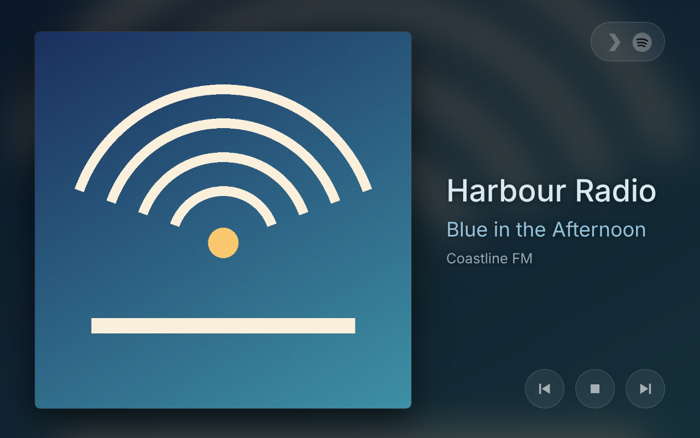
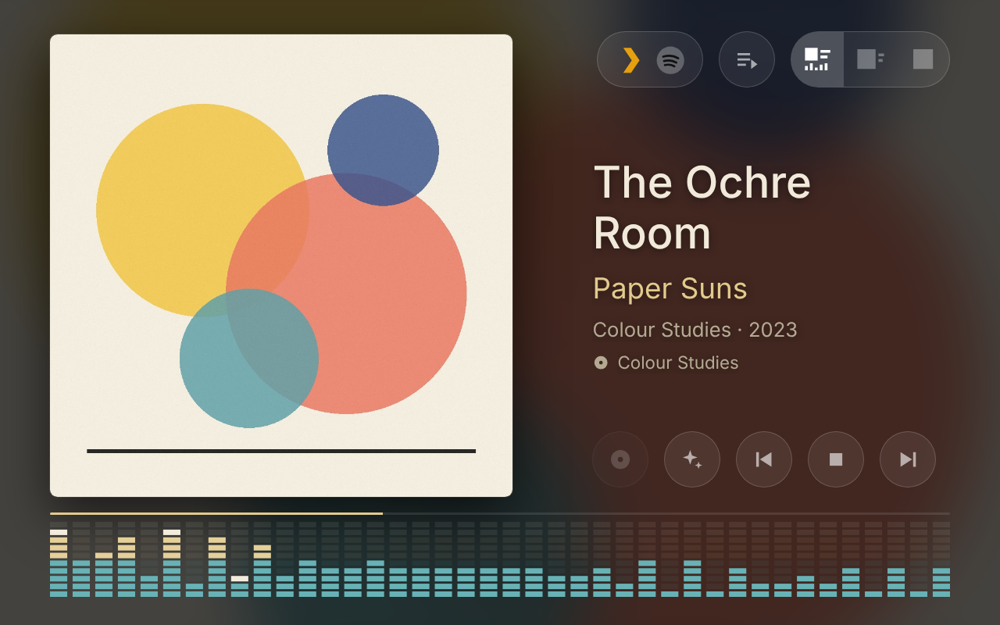

# Now Playing for WiiM

A now-playing display and touch remote for a **WiiM** streamer/amp, running on an old Android tablet next to the hi-fi. Whatever plays on the WiiM (Spotify Connect, AirPlay, radio, …) appears with cover art and track info and can be controlled from the tablet. The display turns off when the music stops and back on when it starts.

A **Raspberry Pi** on the WiiM's optical input runs the display server. Music played **through the Pi** (Plexamp on the Pi, or Spotify Connect to the Pi's device "PlexAmpPi") additionally gets the retro **LED spectrum** in the cover's colors and full controls.

| On the WiiM (Spotify Connect, AirPlay, radio …) | Through the Pi: with LED spectrum |
|---|---|
|  |  |
| **Playlist picker** | **Colors follow the cover** |
|  |  |

## What you get where

| You play … | Tablet view | LED spectrum | Controls |
|---|---|---|---|
| Spotify Connect, AirPlay, radio … **to the WiiM** | WiiM view (title, artist, album, cover) | no | previous / play-pause / next, switch to Plex on the Pi |
| Plexamp **to the Pi** (Caldera) | full view (+ year, playlist or "Track n of m", up next, progress) | yes | all: play-pause, previous / next, Song Radio, play album, playlists with favorites and shuffle, Plex ↔ Spotify switch |
| Spotify Connect **to "PlexAmpPi"** | full view (+ playlist) | yes | play-pause, previous / next, play album, playlists, Plex ↔ Spotify switch (needs the one-time Spotify Web API setup) |

The spectrum is computed from the audio passing through the Pi, so music playing directly on the WiiM can't have one.

## Features

- **Source switch:** one button toggles between Plex and Spotify on the Pi. In the WiiM view it pauses the WiiM, sets it to the optical input and resumes Plex on the Pi (shown when Plexamp is set up on the Pi).
- **Only one source at a time:** the WiiM switches to its optical input by itself when music starts on the Pi; the Pi pauses when the WiiM starts its own music; Plex and Spotify on the Pi never play at once.
- **Display:** 40-band LED spectrum at 30 frames/s in the cover's colors, crossfade on track change, three layouts (full, without spectrum, cover only).
- **Tablet app:** full screen, native spectrum drawing, display on/off, self-healing watchdog, autostart. Runs on Android 5+.

## How it works

```
radio, AirPlay, Spotify, … ───────────────────────► WiiM Amp ─► speakers
                                                     ▲    ▲
Plexamp ─► Caldera ──┐                       optical │    │ HTTP API
                     ├─► Raspberry Pi ─► HiFiBerry ──┘    │
Spotify ─► librespot ┘    ├─ np-server :8080 ◄────────────┘
                          │    track info, covers, commands
                          └─ np-spectrum-server :8090
                               40 bands, 30×/s
                                     │
                                     ▼
                          Android tablet (app, full screen)
```

A small server on the Pi polls the WiiM (every 5 s) and, if set up, Caldera, the Plex server, librespot and the Spotify Web API. Audio played through the Pi passes untouched to the WiiM; a copy feeds the spectrum. Python 3 standard library plus numpy, no Docker, no cloud. The tablet only needs to reach the Pi.

## Setup

1. **Raspberry Pi:** [raspberry/README.md](raspberry/README.md). Copy the folder, run `sudo ./install.sh`, optionally do the one-time Spotify login.
2. **Tablet:** [tablet-app/README.md](tablet-app/README.md). Install the APK (built by GitHub Actions), enter `http://<Pi>:8080`, enable display control.

Settings live in `/etc/default/nowplaying` (template: [`raspberry/nowplaying.default.example`](raspberry/nowplaying.default.example)). `WIIM_HOST` alone gives you the WiiM view. For the LED spectrum, also set up Plexamp on the Pi (`PLEX_URL`, `PLEX_TOKEN`) and/or Spotify Connect (installed by default).

**Language:** the display is German by default; set `UI_LANG=en` for English. The app's own dialogs follow the Android system language.

## Requirements

- A WiiM streamer/amp with an optical input (developed with a WiiM Amp)
- A Raspberry Pi with a HiFiBerry Digi (optical out to the WiiM), Debian/Raspberry Pi OS
- Any Android 5+ tablet (developed on a Lenovo Yoga Tab 3)
- Optional: Plexamp headless (Caldera) with a Plex server; Spotify Premium for Spotify control

## Security

- **Home network only.** Ports 8080 and 8090 have no authentication; anyone who reaches them can control the music. Don't expose them to the internet.
- **Credentials** (Plex token, Spotify login) stay on the Pi and are git-ignored.
- **The app's signing key is public** (`tablet-app/keystore/`, password in `build.gradle`) so every build installs as an update. It protects nothing: only install APKs you built yourself, and use your own key if you distribute the app.

## License

[MIT](LICENSE). The screenshots use made-up tracks and generated cover art.
