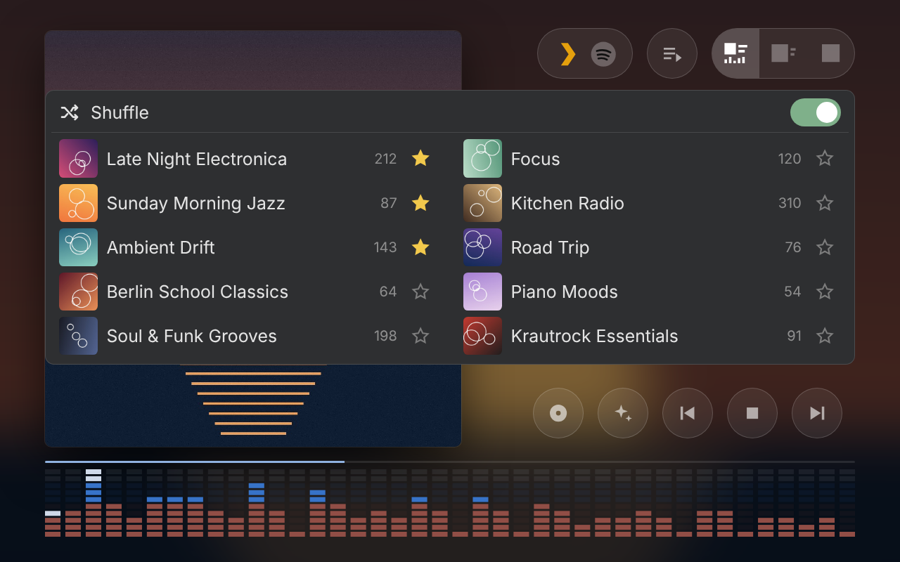

# Now Playing for WiiM

A now-playing display and touch remote for a **WiiM** streamer/amp, running on an old Android tablet next to the hi-fi. Whatever the WiiM plays (radio, AirPlay, Spotify, …) appears with cover art and track info and can be controlled from the tablet. The display turns off when the music stops and back on when it starts.

A **Raspberry Pi** on the WiiM's optical input adds the retro **LED spectrum** in the cover's colors. Plexamp and Spotify played through the Pi get the spectrum plus extra controls: playlists, Song Radio, album, and a Plex ↔ Spotify switch.

| WiiM (radio, AirPlay, …) | Through the Pi: with LED spectrum |
|---|---|
|  |  |
| **Playlist picker** | **Colors follow the cover** |
|  |  |

## Features

- **WiiM:** shows whatever plays directly on the WiiM, with previous/play/next. The WiiM switches to its optical input by itself when music starts on the Pi, and the Pi pauses when the WiiM starts its own music. One tap on the source switch goes back to Plex.
- **LED spectrum:** 40 bands at 30 frames/s in the cover's colors, for everything played through the Pi.
- **Plexamp and Spotify via the Pi:** artist, title, album and year, playlist or "Track n of m", up next, progress; play/pause, previous/next, Song Radio (Plex only), play album, playlists with favorites and shuffle, Plex ↔ Spotify switch. Only one source plays at a time.
- **Layouts:** full, without spectrum, cover only; crossfade on track change.
- **Tablet app:** full screen, native spectrum drawing, display on/off, self-healing watchdog, autostart. Runs on Android 5+.

## How it works

```
radio, AirPlay, Spotify, … ───────────────────────► WiiM Amp ─► speakers
                                                     ▲    ▲
Plexamp ─► Caldera ──┐                       optical │    │ HTTP API
                     ├─► Raspberry Pi ─► HiFiBerry ──┘    │
Spotify ─► librespot ┘    ├─ np-server :8080 ◄────────────┘
                          │    track info, covers, commands
                          └─ np-spectrum-server :8090
                               40 bands, 30×/s
                                     │
                                     ▼
                          Android tablet (app, full screen)
```

A small server on the Pi polls the WiiM and, if set up, Caldera, the Plex server, librespot and the Spotify Web API. Audio played through the Pi passes untouched to the WiiM; a copy feeds the spectrum. Music playing directly on the WiiM never touches the Pi, so it has no spectrum. Python 3 standard library plus numpy, no Docker, no cloud. The tablet only needs to reach the Pi.

## Setup

1. **Raspberry Pi:** [raspberry/README.md](raspberry/README.md). Copy the folder, run `sudo ./install.sh`, optionally do the one-time Spotify login.
2. **Tablet:** [tablet-app/README.md](tablet-app/README.md). Install the APK (built by GitHub Actions), enter `http://<Pi>:8080`, enable display control.

Settings live in `/etc/default/nowplaying` (template: [`raspberry/nowplaying.default.example`](raspberry/nowplaying.default.example)). Only `WIIM_HOST` is needed; Plex and Spotify are optional.

**Language:** the display is German by default; set `UI_LANG=en` for English. The app's own dialogs follow the Android system language.

## Requirements

- A WiiM streamer/amp with an optical input (developed with a WiiM Amp)
- A Raspberry Pi with a HiFiBerry Digi (optical out to the WiiM), Debian/Raspberry Pi OS
- Any Android 5+ tablet (developed on a Lenovo Yoga Tab 3)
- Optional: Plexamp headless (Caldera) with a Plex server; Spotify Premium for Spotify control

## Security

- **Home network only.** Ports 8080 and 8090 have no authentication; anyone who reaches them can control the music. Don't expose them to the internet.
- **Credentials** (Plex token, Spotify login) stay on the Pi and are git-ignored.
- **The app's signing key is public** (`tablet-app/keystore/`, password in `build.gradle`) so every build installs as an update. It protects nothing: only install APKs you built yourself, and use your own key if you distribute the app.

## License

[MIT](LICENSE). The screenshots use made-up tracks and generated cover art.
