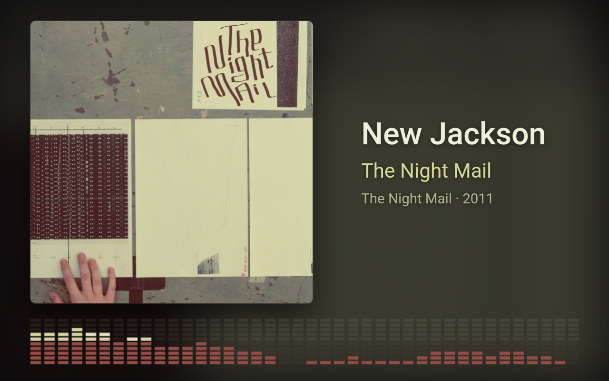
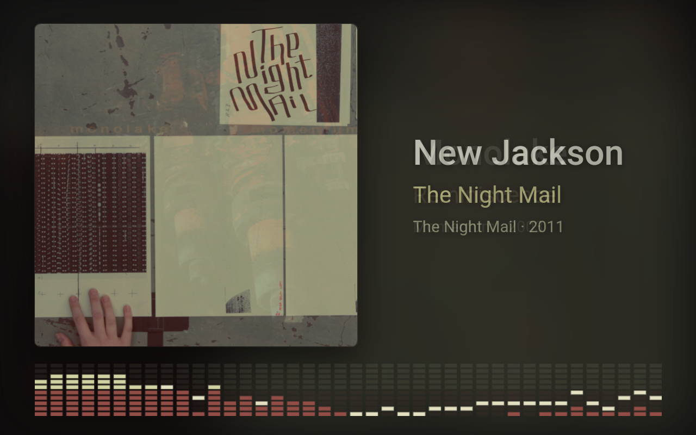
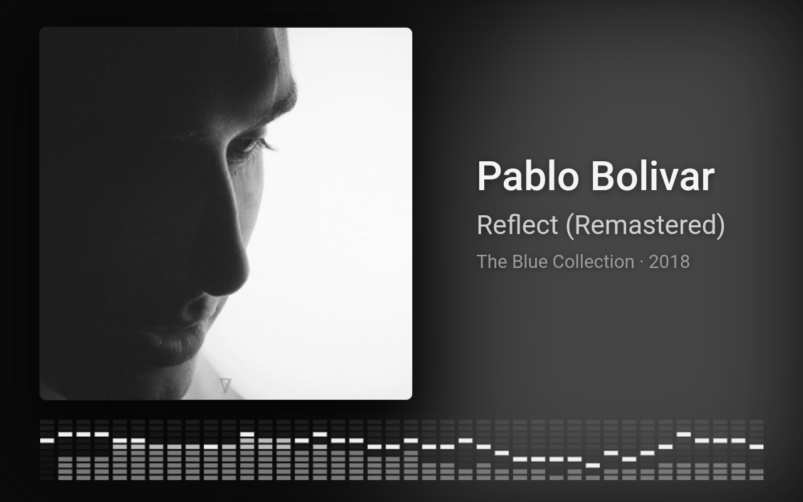

# Now Playing – Albumcover auf dem Lenovo Yoga

Ein altes Lenovo Yoga Tab 3 steht quer neben der Anlage und zeigt, was gerade läuft: links das Cover, rechts Interpret, Titel, Album und Jahr, unten eine LED-Leiste im Retro-Stil (Spektrumanalysator) in den Farben des Covers. Bei einem Titelwechsel blendet alles weich über. Läuft keine Musik, geht das Display nach ein paar Sekunden aus und mit der nächsten Musik von selbst wieder an.



| Titelwechsel (Überblendung) | Helles Cover |
|---|---|
|  |  |

---

## Inhalt

| Ordner | Was | Wohin |
|---|---|---|
| [`raspberry/`](raspberry/) | Anzeige-Server, Spektrum-Dienst, Einrichtung von Spotify Connect „PlexAmpPi“ | Raspberry „PlexAmpPi“ |
| [`tablet-app/`](tablet-app/) | Android-App für das Yoga (Quellcode) | wird zur APK, dann aufs Tablet |
| [`vorschau/`](vorschau/) | Bildschirmfotos vom echten Tablet | nur zum Ansehen |

Jeder Ordner hat eine eigene `ANLEITUNG.md` mit allen Einzelschritten. Diese Datei gibt den Überblick.

---

## So hängt alles zusammen

```
Plexamp (Handy) ──► Caldera ──┐
                              ├─► Raspberry „PlexAmpPi“ ─► HiFiBerry Digi ─► Toslink ─► WiiM Amp ─► Lautsprecher
Spotify (Handy) ──► librespot ┘        │
                                       ├─ Spektrum-Dienst (Port 8090) ── 40 Bänder, 30×/s ───┐
Plex-Server (NAS) ── Titel, Cover ────►├─ Anzeige-Server  (Port 8080) ───────────────────────┼─► Lenovo Yoga
WiiM (Radio, AirPlay) ── Titel, Cover ►┘   Songinfos, Cover, nächster Titel, Display an/aus    ┘   (App, Vollbild)
```

Der Raspberry erledigt alles. Die NAS liefert nur die Musik und über Plex Titel und Cover; ein Docker-Container ist nicht nötig.

### Woher die Anzeige ihre Daten hat

| Was läuft | Quelle | Jahr | Nächster Titel vorgeladen | LED-Leiste |
|---|---|---|---|---|
| Plexamp → **PlexAmpPi** (Caldera) | Caldera auf dem Pi, Angaben und Cover vom Plex-Server | ja (Albumjahr) | ja | ja |
| Spotify → **PlexAmpPi** (librespot) | librespot meldet jeden Titelwechsel | – | – | ja |
| Direkt auf dem WiiM (Radio, AirPlay, Spotify → WiiM) | Schnittstelle des WiiM | – | – | – |

### Was das Tablet anzeigt

| Zustand | Anzeige |
|---|---|
| Musik läuft | Cover links; rechts Interpret (groß), Titel, Album · Jahr in Farben aus dem Cover; unten die LED-Leiste; unscharfer Cover-Hintergrund |
| Titelwechsel | Cover, Hintergrund, Text und Farben blenden in 1,5 s über. Bei Plexamp ist das nächste Cover schon vorgeladen. |
| Pause oder Musik zu Ende | Cover und Text abgedunkelt, nach 10 s (`OFF_DELAY`) geht das Display aus |
| Keine Musik | Display aus. Startet Musik, geht es nach 1–3 s wieder an. |
| Von Hand geweckt, ohne Musik | geht nach 1 Minute wieder aus (5 Minuten, wenn eine andere App oder die Einstellungen offen sind) |

Helle Cover dunkeln den Hintergrund stärker ab, schwarze Cover bekommen einen feinen Rand, damit Text und Cover immer lesbar bleiben.

### Wichtig im Alltag

- Für Musik über den Pi muss der WiiM auf dem **optischen Eingang** stehen.
- **Lautstärke nur am WiiM regeln.** Caldera und Spotify auf dem Pi liefern vollen Pegel.
- Caldera und Spotify teilen sich den Pi: Es spielt immer nur einer. Erst den einen pausieren, dann den anderen starten.
- Spotify auf dem Pi: Alben und Playlists laufen durch; nach einem Einzeltitel stoppt die Wiedergabe, weil Autoplay dort nicht lädt.

---

## Einrichtung

1. **Raspberry:** [`raspberry/ANLEITUNG.md`](raspberry/ANLEITUNG.md) – Ordner auf den Pi kopieren, `sudo ./install.sh`.
2. **Tablet:** [`tablet-app/ANLEITUNG.md`](tablet-app/ANLEITUNG.md) – APK bauen und installieren, Adresse des Pi eintragen, Display-Steuerung aktivieren, Bildschirmsperre „Keine“.

### Einstellungen

| Was | Datei auf dem Pi | Vorlage im Repository |
|---|---|---|
| Anzeige-Server (Plex, WiiM, `OFF_DELAY`) | `/etc/default/nowplaying` | `raspberry/nowplaying.default.beispiel` |
| Spektrum (`DELAY_MS`, Empfindlichkeit) | `/etc/default/nowplaying-spectrum` | `raspberry/nowplaying-spectrum.default` |
| Spotify Connect | `/etc/raspotify/conf` | wird von `install.sh` gesetzt |

Der Plex-Token gehört in `raspberry/nowplaying.env` (lokale Kopie der Vorlage). Diese Datei ist per `.gitignore` vom Repository ausgeschlossen.

---

## Eingerichteter Stand (14.11.2026)

- **Raspberry** „PlexAmpPi“ (Pi 3B, HiFiBerry Digi, Debian 13, 192.168.178.68): Dienste `nowplaying`, `nowplaying-spectrum`, `raspotify` laufen.
  Caldera: Abtastrate der Quelle, Lautstärke 100, Lautheitsangleichung und Übergänge an. Spektrum-Verzögerung `DELAY_MS=40`.
- **Tablet** Lenovo Yoga Tab 3 8" (YT3-850L, Android 6.0.1, 192.168.178.109): App 1.7, Adresse `http://192.168.178.68:8080`, Display-Steuerung aktiv, Bildschirmsperre „Keine“, nicht benötigte Apps entfernt bzw. deaktiviert, USB-Debugging an.
- **Getestet** mit echter Musik: Plexamp und Spotify über den Pi mit Cover, Songinfos und Leiste; WiiM direkt mit Cover; Überblendung bei Titelwechsel; Display aus bei Pause und wieder an bei Play.

---

## Fehlersuche: Wo anfangen?

| Was du siehst | Wo nachsehen |
|---|---|
| Tablet zeigt gar nichts oder einen Ladefehler | Adresse in der App prüfen (lange drücken); läuft `nowplaying` auf dem Pi? |
| Display bleibt aus, obwohl Musik läuft | `http://192.168.178.68:8080/setup`: Zeigt eine Quelle einen Fehler? |
| Cover da, aber keine Leiste | Läuft die Musik über PlexAmpPi? `curl http://192.168.178.68:8090/status` |
| Leiste läuft dem Ton voraus oder hinterher | `DELAY_MS` in `/etc/default/nowplaying-spectrum` anpassen |
| Kein Ton über den Pi | WiiM auf optischem Eingang? Spielt gerade der andere Player (Caldera/Spotify)? |
| Display geht ohne Musik nicht aus | In der App lange drücken → „Display-Steuerung aktivieren“ |

---

## Technik in Kürze

- **Anzeige-Server** (`raspberry/np-server`): Python 3, nur Standardbibliothek, systemd-Dienst. Fragt Caldera lokal ab (Plex-Companion-Schnittstelle), liest Calderas Warteschlange für den nächsten Titel, bekommt Spotify-Ereignisse von librespot und fragt den WiiM ab. Alle Cover laufen über den Server und werden vorab zwischengespeichert; so gibt es keine Zertifikatsprobleme mit dem alten Android.
- **Anzeigeseite** (`raspberry/index.html`): ES5-JavaScript für das alte Android-WebView. Zwei Ebenen zum Überblenden, Cover-Farben aus einem 32×32-Abbild des Covers, Abfrage jede Sekunde. Die Leiste wird nur gezeichnet, wenn sie sichtbar ist und sich etwas ändert (30 Bilder/s; Tablet-Last ohne Leiste ca. 4 %, mit Leiste ca. 35 %).
- **Spektrum** (`np-spectrum-feed`, `np-spectrum-server`): Das ALSA-Gerät `nowplaying` reicht das Signal unverändert an die HiFiBerry weiter und gibt eine Kopie ab. Daraus werden per FFT (numpy) 40 Bänder von 40 Hz bis 16 kHz und per Server-Sent Events ans Tablet geschickt. Kommt der Dienst nicht hinterher, wird die Kopie verworfen – die Musik läuft immer weiter.
- **Spotify Connect:** Raspotify (librespot 0.8), feste Lautstärke, Lautheitsangleichung an, Ereignisse über `np-librespot-event`.
- **Tablet-App** (`tablet-app/`): Java, ohne Fremdbibliotheken, ab Android 5. Zeigt die Seite im Vollbild, fragt alle 3 s den Display-Zustand ab, schaltet das Display per Geräteadministrator aus und per WakeLock wieder ein und startet nach einem Neustart von selbst.
